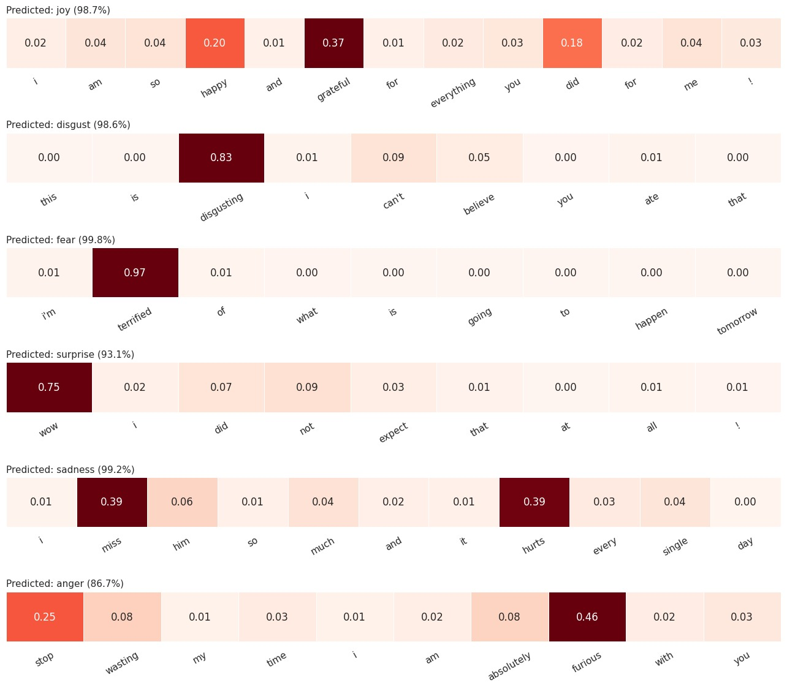
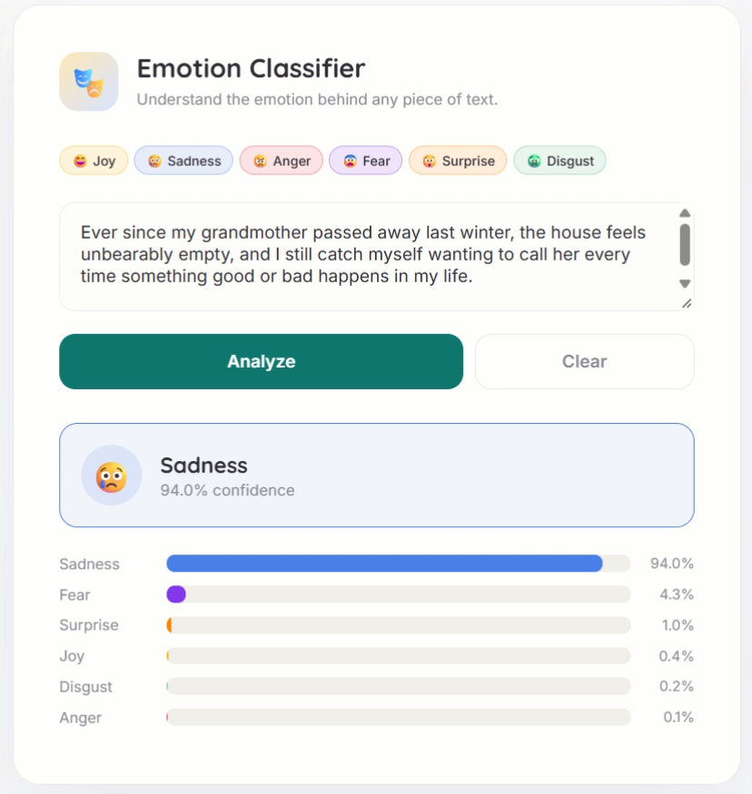
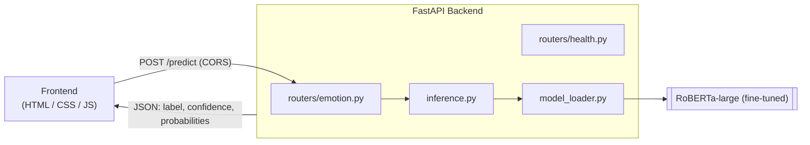

# Emotion Classification with Attention


[](https://huggingface.co/Ahmed-Tarek0/emotion-roberta-large)

A multi-class emotion classifier that maps free text to one of six core emotions — **joy, sadness, anger, fear, surprise, disgust** — comparing four architectures (LSTM, GRU, BiLSTM + Attention, fine-tuned RoBERTa-large) on a GoEmotions-based dataset augmented with ISEAR, and served through a small FastAPI + vanilla-JS deployment.

🤗 **Pretrained model**: [Ahmed-Tarek0/emotion-roberta-large](https://huggingface.co/Ahmed-Tarek0/emotion-roberta-large) — ready to use, no need to retrain.

## Table of contents

- [Overview](#overview)
- [Results](#results)
- [Data pipeline](#data-pipeline)
- [Model architectures](#model-architectures)
- [Repository structure](#repository-structure)
- [Getting started](#getting-started)
  - [1. Notebook](#1-notebook)
  - [2. Deployment](#2-deployment)
- [Deployment architecture](#deployment-architecture)
- [API reference](#api-reference)
- [Tech stack](#tech-stack)
- [Notes & limitations](#notes--limitations)

## Overview

GoEmotions is Google's 28-label, multi-label emotion dataset built from Reddit comments. Most of those 28 labels are too fine-grained to be useful on their own (the difference between "admiration" and "approval" is rarely what a downstream application cares about), so this project maps them onto Paul Ekman's 6 universally recognized core emotions instead: joy, sadness, anger, fear, surprise, and disgust. That mapping decision alone shapes most of the rest of the project, because it turns a reasonably balanced 28-way multi-label problem into a 6-way single-label one where two of the classes (`disgust` and `fear`) end up with very little data to learn from.

The goal was to treat that imbalance as a real engineering problem rather than something to paper over with a bigger model. Four classifiers were trained on identical data splits so the comparison would mean something: two single-direction RNNs (LSTM, GRU), a bidirectional one with an attention mechanism on top (so predictions are at least partly interpretable), and a fine-tuned `roberta-large` transformer as the strongest baseline. Along the way, the data pipeline went through three iterations (label resolution, external augmentation, and a correction to the class-balancing strategy) before the numbers below actually held up under proper evaluation. The best model is now wrapped in a small FastAPI service with a working frontend, and also published on the HuggingFace Hub so it can be used without retraining anything.

**What's in this repo:**
- `notebook.ipynb` — the full training pipeline: data loading, label mapping, cleaning, GloVe embeddings, four model architectures, evaluation, and attention visualization.
- `deployment/` — a FastAPI backend + static frontend serving the fine-tuned model.
- `assets/` — result charts and app screenshots referenced below.

## Results

All four models were evaluated on the exact same held-out test split, with unambiguous, single-label ground truth (see [Data pipeline](#data-pipeline) for what that means in practice). Accuracy is reported alongside macro F1, since the classes are imbalanced enough that accuracy alone would be misleading, a model that always predicted `joy` would already score decently on accuracy while being useless on everything else.

| Model | Accuracy | Macro F1 |
|---|---|---|
| LSTM | 74.3% | 0.636 |
| GRU | 74.7% | 0.645 |
| BiLSTM + Attention | 75.8% | 0.662 |
| **RoBERTa-large (fine-tuned)** | **81.3%** | **0.716** |


`roberta-large` wins on both metrics, but the gap to the custom RNNs is smaller than its size advantage (355M parameters vs. a few million) would suggest, which says more about how much signal is in the data than about any particular architecture. The bidirectional attention model also consistently edges out the plain LSTM and GRU, for the unsurprising reason that it can look at the whole sentence at once instead of compressing everything into a single final hidden state.

**Per-class breakdown.** Looking at the aggregate numbers hides where the real difficulty is. Broken down by emotion, `joy` is solved almost perfectly by every model (F1 in the high 0.80s to low 0.90s), while `disgust` sits well below every other class across the board, even for the best model:


That gap is a direct consequence of `disgust` being the rarest emotion in the source data: even after pulling in extra examples from ISEAR (see below), there just isn't as much signal to learn from as there is for the far more common `joy` and `anger`.

**Confusion matrix** for the best model (`roberta-large`). Most of the remaining mistakes aren't random, they cluster between semantically close classes: `anger` gets confused with `surprise` more than with anything else, and `disgust` is most often mistaken for `anger`, which tracks with how those emotions are often expressed in similar, high-intensity language:


**Training curves** for the three custom models. Validation macro F1 plateaus around epoch 6-7 for all three, but LSTM is the one to watch: its training loss keeps dropping well past that point while its validation metrics flatten and even dip slightly, a classic early sign of overfitting that the other two architectures don't show nearly as much:


**Attention visualization.** Since the custom models don't come with built-in interpretability the way some larger models do, the BiLSTM + Attention model's attention weights were plotted directly on a handful of example sentences, to check that it's actually picking up on the right words rather than getting the right answer for the wrong reason. On the examples below, the heaviest weight consistently lands on the emotionally loaded word in the sentence, `grateful`, `disgusting`, `terrified`, `furious`, which is a reassuring sign that the model's attention mechanism is doing what it's supposed to rather than attending to filler words:



## Data pipeline

Getting the per-class results above took more than just picking a model. Three decisions in the data pipeline mattered as much as the architecture choice:

**Label mapping.** GoEmotions' 27 fine-grained emotions (plus `neutral`) are grouped into the 6 Ekman emotions using a fixed mapping table. `neutral`-only examples carry no target emotion and are dropped everywhere. The trickier case is an example whose original labels span more than one of the 6 target emotions: an earlier version of this pipeline resolved those consistently across train, validation, and test by assigning them to the rarer emotion, which seemed reasonable until it became clear that doing so on the evaluation sets was quietly redefining the ground truth itself. That inflated some recall numbers and tanked precision in a way that had nothing to do with model quality. The fix was to only apply that resolution to the **training** split; validation and test simply drop ambiguous examples, so every number reported above is measured against ground truth that was never a judgment call.

**ISEAR augmentation.** Even after the label mapping, `disgust` and `fear` are left with only a few hundred training examples each, nowhere near enough for any model to learn them well. Rather than oversampling the few examples that exist (which just means a model memorizes the same handful of sentences repeatedly), real, previously unseen examples for those two emotions were pulled in from ISEAR, a separate self-report emotion dataset, and added to the training split only:


**Class balancing.** Oversampling (`WeightedRandomSampler` for the RNNs) and a weighted loss (for the transformer) are still used on top of the extra data, since `joy` is still far more common than everything else even after augmentation. The first version of this used full inverse-frequency weighting, the textbook approach, and it overcorrected hard: the model started predicting `disgust` far too eagerly, so recall went up while precision collapsed. Dampening the weights with a `sampling_alpha` of 0.5 (so the sampler works off √count rather than raw inverse-frequency) fixed that balance and improved every class, not just the rare ones.

## Model architectures

| Model | Description |
|---|---|
| LSTM | Embedding (GloVe) → LSTM → last hidden state → linear classifier |
| GRU | Same, with a GRU cell |
| BiLSTM + Attention | Bidirectional LSTM with additive attention over all hidden states |
| RoBERTa-large | Fine-tuned end-to-end with the HuggingFace `Trainer` API |

## Repository structure

```
.
├── notebook.ipynb              # training pipeline (data -> 4 models -> evaluation)
├── assets/                     # charts used in this README
├── deployment/
│   ├── backend/
│   │   ├── app/
│   │   │   ├── routers/
│   │   │   │   ├── emotion.py      # POST /predict
│   │   │   │   └── health.py       # GET /health
│   │   │   ├── config.py           # settings, loaded from .env
│   │   │   ├── model_loader.py     # loads the model once (singleton)
│   │   │   ├── inference.py        # tokenize -> forward pass -> softmax
│   │   │   ├── schemas.py          # request/response models
│   │   │   └── main.py             # app setup, CORS, routers
│   │   ├── finetuned_transformer/  # model files (NOT committed - see Notes)
│   │   ├── .env.example
│   │   └── run.py
│   ├── frontend/
│   │   ├── index.html
│   │   ├── style.css
│   │   └── script.js
│   └── requirements.txt
└── README.md
```

## Getting started

### 1. Notebook

Open `notebook.ipynb` in Google Colab or Jupyter with a GPU runtime, and run all cells top to bottom. It downloads GoEmotions and ISEAR automatically, trains all four models, and saves the fine-tuned transformer plus result charts under `artifacts/`.

### 2. Deployment

```bash
cd deployment
pip install -r requirements.txt
cd backend
cp .env.example .env        # adjust if needed
```

Get the fine-tuned model one of two ways:
- **Download it** from the [HuggingFace Hub page](https://huggingface.co/Ahmed-Tarek0/emotion-roberta-large) and place its files at `deployment/backend/finetuned_transformer/` (must contain `config.json`, `model.safetensors`, `tokenizer.json`, `tokenizer_config.json`), **or**
- **Point the backend straight at the Hub** by setting `MODEL_DIR=Ahmed-Tarek0/emotion-roberta-large` in `deployment/backend/.env` — `transformers` will download and cache it automatically on first run.

See [Notes](#notes--limitations) for why the weights aren't committed to this repo directly.

```bash
python run.py
```

The API is now at `http://127.0.0.1:8000` (interactive docs at `/docs`). Then just open `deployment/frontend/index.html` in a browser — it calls the API at `API_BASE` in `script.js`, which defaults to `http://127.0.0.1:8000`.

#### Preview

<p align="center">
  <br/>
  <sub>Example: sadness, correctly predicted at 94% confidence</sub>
</p>

<p align="center">
  <br/>
  <sub>Example: anger, correctly predicted at 43.7% confidence (the model's main confusion is with surprise, as seen in the confusion matrix above)</sub>
</p>

## Deployment architecture



`model_loader.py` loads the model once at startup (`lru_cache`) rather than per-request. `inference.py` has no HTTP concerns — it can be reused from a script or tested on its own. `routers/` only translates HTTP in and out.

## API reference

### `POST /predict`

```json
// request
{ "text": "I can't believe you did this!" }
```

```json
// response
{
  "label": "anger",
  "confidence": 0.81,
  "color": "#E63946",
  "emoji": "😠",
  "probabilities": {
    "joy": 0.02, "sadness": 0.04, "anger": 0.81,
    "fear": 0.03, "surprise": 0.07, "disgust": 0.03
  }
}
```

### `GET /health`

Returns `{"status": "ok"}` once the model has loaded.

## Tech stack

| Layer | Stack |
|---|---|
| Model | PyTorch, HuggingFace Transformers, RoBERTa-large |
| Data | HuggingFace `datasets`, GoEmotions, ISEAR, GloVe embeddings |
| Backend | FastAPI, Uvicorn, Pydantic |
| Frontend | HTML, CSS, vanilla JavaScript |

## Notes & limitations

- **The fine-tuned model is not committed to this repo.** `model.safetensors` for RoBERTa-large is ~1.4 GB — far past GitHub's 100 MB per-file hard limit, so a plain `git push` would simply be rejected. `deployment/backend/finetuned_transformer/` is git-ignored; it's hosted on the [HuggingFace Hub](https://huggingface.co/Ahmed-Tarek0/emotion-roberta-large) instead — see [Getting started](#2-deployment) for the two ways to use it.
- `disgust` is the weakest class across every model (fewest examples even after augmentation, and it overlaps semantically with `anger`).
- The model expects plain English text and truncates inputs to 64 tokens.

---

Ahmed Tarek