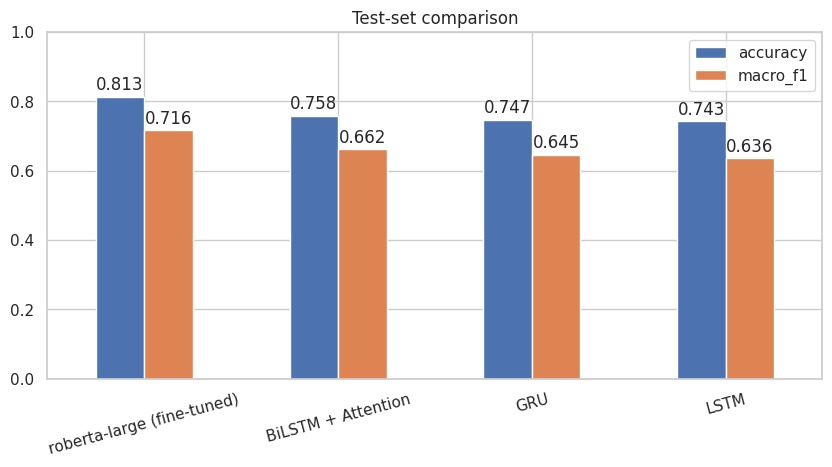
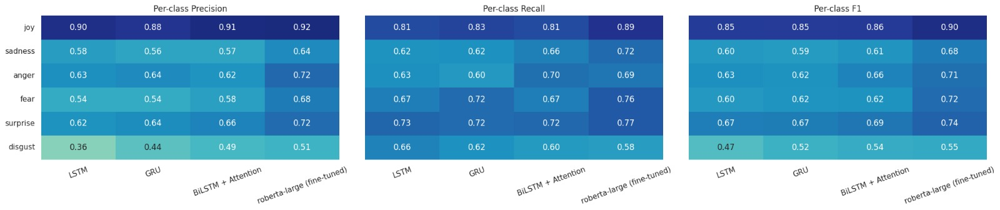
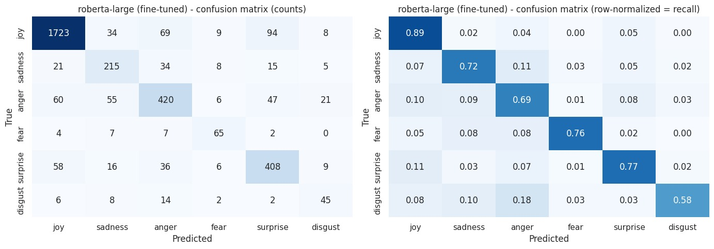
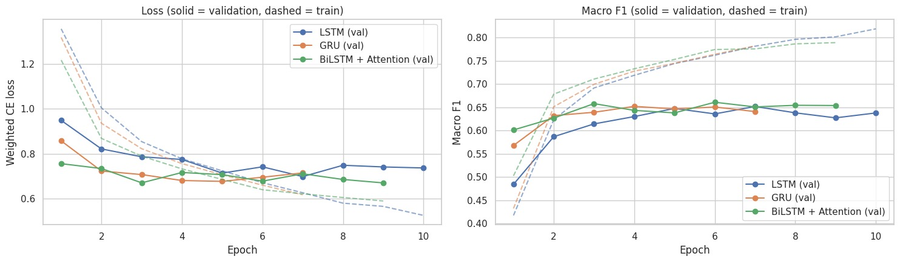
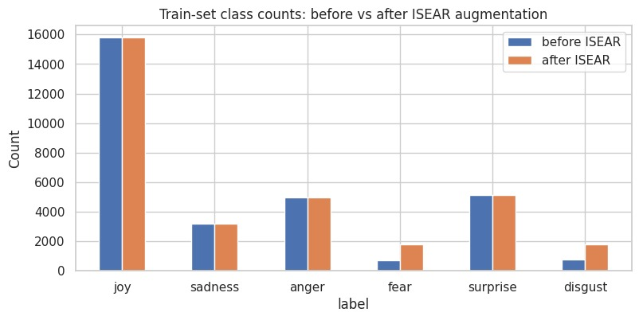
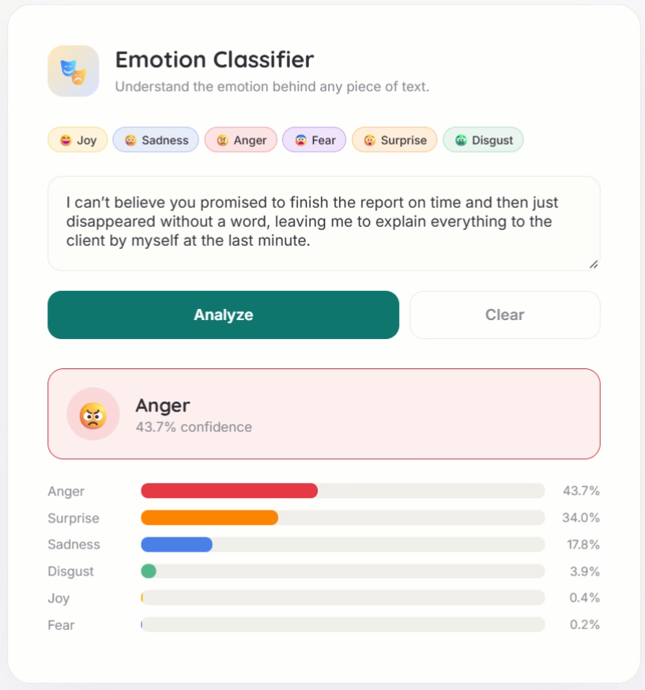
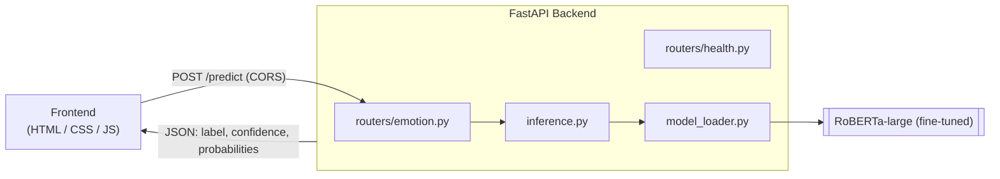

# Emotion Classification with Attention


[](https://huggingface.co/Ahmed-Tarek0/emotion-roberta-large)

A multi-class emotion classifier that maps free text to one of six core emotions — **joy, sadness, anger, fear, surprise, disgust** — comparing four architectures (LSTM, GRU, BiLSTM + Attention, fine-tuned RoBERTa-large) on a GoEmotions-based dataset augmented with ISEAR, and served through a small FastAPI + vanilla-JS deployment.

🤗 **Pretrained model**: [Ahmed-Tarek0/emotion-roberta-large](https://huggingface.co/Ahmed-Tarek0/emotion-roberta-large) — ready to use, no need to retrain.

## Table of contents

- [Overview](#overview)
- [Results](#results)
- [Data pipeline](#data-pipeline)
- [Model architectures](#model-architectures)
- [Repository structure](#repository-structure)
- [Getting started](#getting-started)
  - [1. Notebook](#1-notebook)
  - [2. Deployment](#2-deployment)
- [Deployment architecture](#deployment-architecture)
- [API reference](#api-reference)
- [Tech stack](#tech-stack)
- [Notes & limitations](#notes--limitations)

## Overview

GoEmotions is Google's 28-label, multi-label emotion dataset built from Reddit comments. This project maps its labels onto Paul Ekman's 6 core emotions, trains and compares four classifiers on the result, and ships the best one behind a small web app.

**What's in this repo:**
- `notebook.ipynb` — the full training pipeline: data loading, label mapping, cleaning, GloVe embeddings, four model architectures, evaluation, and attention visualization.
- `deployment/` — a FastAPI backend + static frontend serving the fine-tuned model.
- `assets/` — result charts referenced below.

## Results

Four models, evaluated on the same held-out test split:



`roberta-large` comes out on top on both accuracy and macro F1, with the custom RNNs not far behind despite being a fraction of the size.

**Per-class breakdown** — `disgust` is consistently the hardest class across every model, which tracks with it being the rarest emotion in the data even after augmentation:



**Confusion matrix** for the best model (`roberta-large`) — most of the remaining confusion is between semantically close classes (`anger` / `surprise`, `disgust` / `anger`):



**Training curves** for the three custom models — validation macro F1 plateaus around epoch 6-7, with LSTM showing the earliest sign of overfitting (train loss still dropping as validation flattens):



**Attention visualization** — the BiLSTM + Attention model's weights on a few example sentences, showing which words drove each prediction (`grateful`, `disgusting`, `terrified`, `furious`, ...):


## Data pipeline

- **Label mapping**: GoEmotions' 27 emotions (+ neutral) are mapped to the 6 Ekman emotions. Neutral-only examples are dropped everywhere. Examples whose labels span more than one target emotion are resolved towards the rarer emotion **in train only** — validation/test keep dropping them, so the evaluation ground truth stays unambiguous and comparable across experiments.
- **ISEAR augmentation**: `disgust` and `fear` are the rarest classes in GoEmotions. Real (not duplicated) examples from the ISEAR dataset are added to the training split only:

  

- **Class balancing**: a `WeightedRandomSampler` (for the RNNs) and weighted loss (for the transformer) oversample the rare classes, dampened by a `sampling_alpha` of 0.5 (√count instead of raw inverse-frequency) — full inverse-frequency balancing was tried first and over-corrected `disgust` (high recall, very low precision).

## Model architectures

| Model | Description |
|---|---|
| LSTM | Embedding (GloVe) → LSTM → last hidden state → linear classifier |
| GRU | Same, with a GRU cell |
| BiLSTM + Attention | Bidirectional LSTM with additive attention over all hidden states |
| RoBERTa-large | Fine-tuned end-to-end with the HuggingFace `Trainer` API |

## Repository structure

```
.
├── notebook.ipynb              # training pipeline (data -> 4 models -> evaluation)
├── assets/                     # charts used in this README
├── deployment/
│   ├── backend/
│   │   ├── app/
│   │   │   ├── routers/
│   │   │   │   ├── emotion.py      # POST /predict
│   │   │   │   └── health.py       # GET /health
│   │   │   ├── config.py           # settings, loaded from .env
│   │   │   ├── model_loader.py     # loads the model once (singleton)
│   │   │   ├── inference.py        # tokenize -> forward pass -> softmax
│   │   │   ├── schemas.py          # request/response models
│   │   │   └── main.py             # app setup, CORS, routers
│   │   ├── finetuned_transformer/  # model files (NOT committed - see Notes)
│   │   ├── .env.example
│   │   └── run.py
│   ├── frontend/
│   │   ├── index.html
│   │   ├── style.css
│   │   └── script.js
│   └── requirements.txt
└── README.md
```

## Getting started

### 1. Notebook

Open `notebook.ipynb` in Google Colab or Jupyter with a GPU runtime, and run all cells top to bottom. It downloads GoEmotions and ISEAR automatically, trains all four models, and saves the fine-tuned transformer plus result charts under `artifacts/`.

### 2. Deployment

```bash
cd deployment
pip install -r requirements.txt
cd backend
cp .env.example .env        # adjust if needed
```

Get the fine-tuned model one of two ways:
- **Download it** from the [HuggingFace Hub page](https://huggingface.co/Ahmed-Tarek0/emotion-roberta-large) and place its files at `deployment/backend/finetuned_transformer/` (must contain `config.json`, `model.safetensors`, `tokenizer.json`, `tokenizer_config.json`), **or**
- **Point the backend straight at the Hub** by setting `MODEL_DIR=Ahmed-Tarek0/emotion-roberta-large` in `deployment/backend/.env` — `transformers` will download and cache it automatically on first run.

See [Notes](#notes--limitations) for why the weights aren't committed to this repo directly.

```bash
python run.py
```

The API is now at `http://127.0.0.1:8000` (interactive docs at `/docs`). Then just open `deployment/frontend/index.html` in a browser — it calls the API at `API_BASE` in `script.js`, which defaults to `http://127.0.0.1:8000`.

#### Preview

<p align="center">
  
  
</p>

## Deployment architecture



`model_loader.py` loads the model once at startup (`lru_cache`) rather than per-request. `inference.py` has no HTTP concerns — it can be reused from a script or tested on its own. `routers/` only translates HTTP in and out.

## API reference

### `POST /predict`

```json
// request
{ "text": "I can't believe you did this!" }
```

```json
// response
{
  "label": "anger",
  "confidence": 0.81,
  "color": "#E63946",
  "emoji": "😠",
  "probabilities": {
    "joy": 0.02, "sadness": 0.04, "anger": 0.81,
    "fear": 0.03, "surprise": 0.07, "disgust": 0.03
  }
}
```

### `GET /health`

Returns `{"status": "ok"}` once the model has loaded.

## Tech stack

| Layer | Stack |
|---|---|
| Model | PyTorch, HuggingFace Transformers, RoBERTa-large |
| Data | HuggingFace `datasets`, GoEmotions, ISEAR, GloVe embeddings |
| Backend | FastAPI, Uvicorn, Pydantic |
| Frontend | HTML, CSS, vanilla JavaScript |

## Notes & limitations

- **The fine-tuned model is not committed to this repo.** `model.safetensors` for RoBERTa-large is ~1.4 GB — far past GitHub's 100 MB per-file hard limit, so a plain `git push` would simply be rejected. `deployment/backend/finetuned_transformer/` is git-ignored; it's hosted on the [HuggingFace Hub](https://huggingface.co/Ahmed-Tarek0/emotion-roberta-large) instead — see [Getting started](#2-deployment) for the two ways to use it.
- `disgust` is the weakest class across every model (fewest examples even after augmentation, and it overlaps semantically with `anger`).
- The model expects plain English text and truncates inputs to 64 tokens.

---

Ahmed Tarek